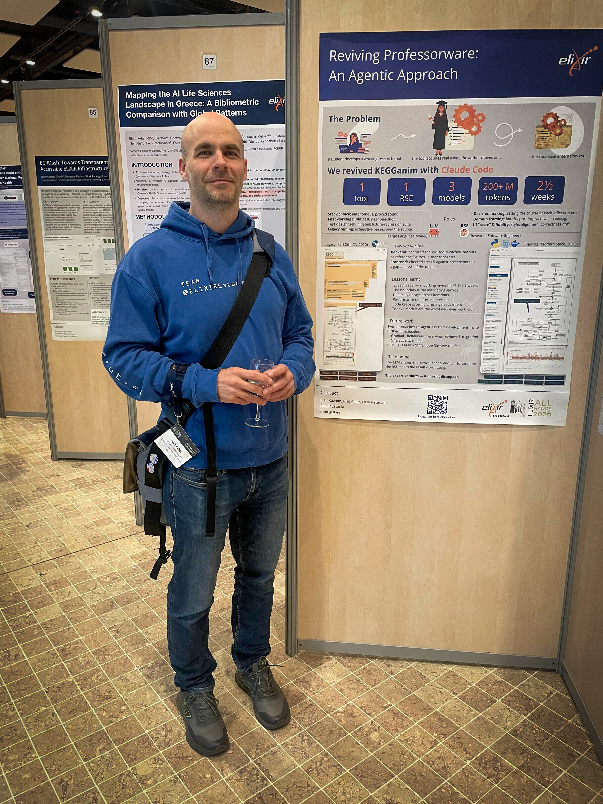

# Reviving Professorware: An Agentic Approach

Research software often follows a familiar path: a student develops a tool as part of their research, the tool gains real users, and eventually the student moves on. The software, however, remains at the institute, lacking the time, resources, or expertise needed for further development and maintenance. Over time, useful research tools can become static, even as researchers continue to rely on them. **Could AI help bring some of these tools back to life?**

<!-- more -->

At the [ELIXIR All Hands Meeting 2026](https://elixir-europe.org/events/elixir-all-hands-2026), we explored this question in a poster presenting our experience with **[KEGGanim](https://biit.cs.ut.ee/kegganim/)**, one of our older research tools. We wanted to see whether modern AI could help us understand, review and revive a legacy research tool, and what role research software engineering expertise would still play in the process.

We used an agentic approach with **Claude Code**, combining the capabilities of a Large Language Model (LLM) with the expertise of a Research Software Engineer (RSE). In just **2½ weeks**, we produced a working modern version of KEGGanim, using more than 200 million tokens across three different models.

The process included mining the legacy code, creating an initial working version, testing it against the original tool, and checking that the user interface and behaviour remained faithful to the original.

One of the most interesting lessons was that **the expertise doesn't disappear when the original developer moves on; it shifts**. AI can make the initial revival of an old tool considerably faster and more accessible, but the RSE remains essential for making decisions along the way: what should be preserved, what can be redesigned, and how can we verify that the revived tool actually works as intended?

Our experiment also highlighted some limitations. UI fidelity can decline over successive iterations, code can continue to grow without active scope management, and current AI models still struggle most with the more complex parts of legacy systems.

Overall, our experience suggests that **agent-assisted development could provide a practical new approach to preserving and reviving research software**. Rather than replacing software engineering expertise, AI may change how and where that expertise is used — potentially making it possible to revisit research tools that would otherwise remain untouched.

[The poster](https://doi.org/10.5281/zenodo.23473552) was presented by the ELIXIR Estonia team at the ELIXIR All Hands Meeting 2026. 
