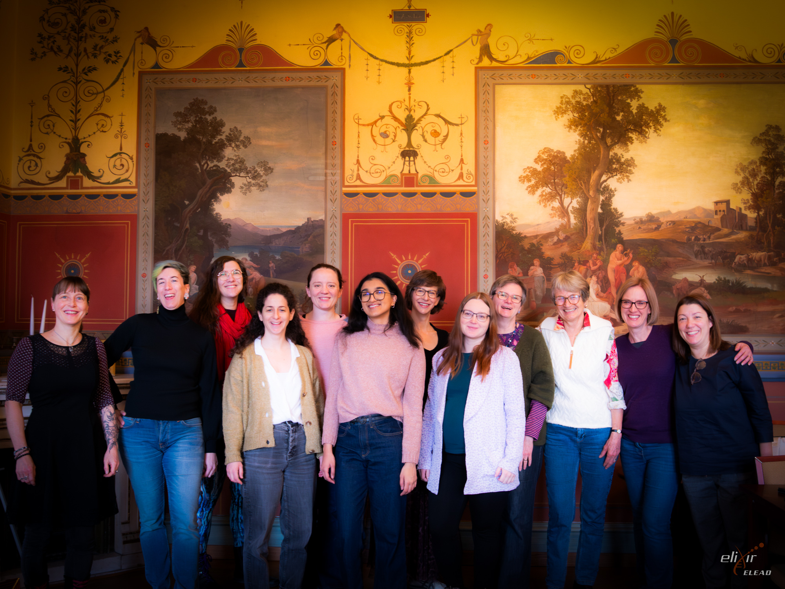
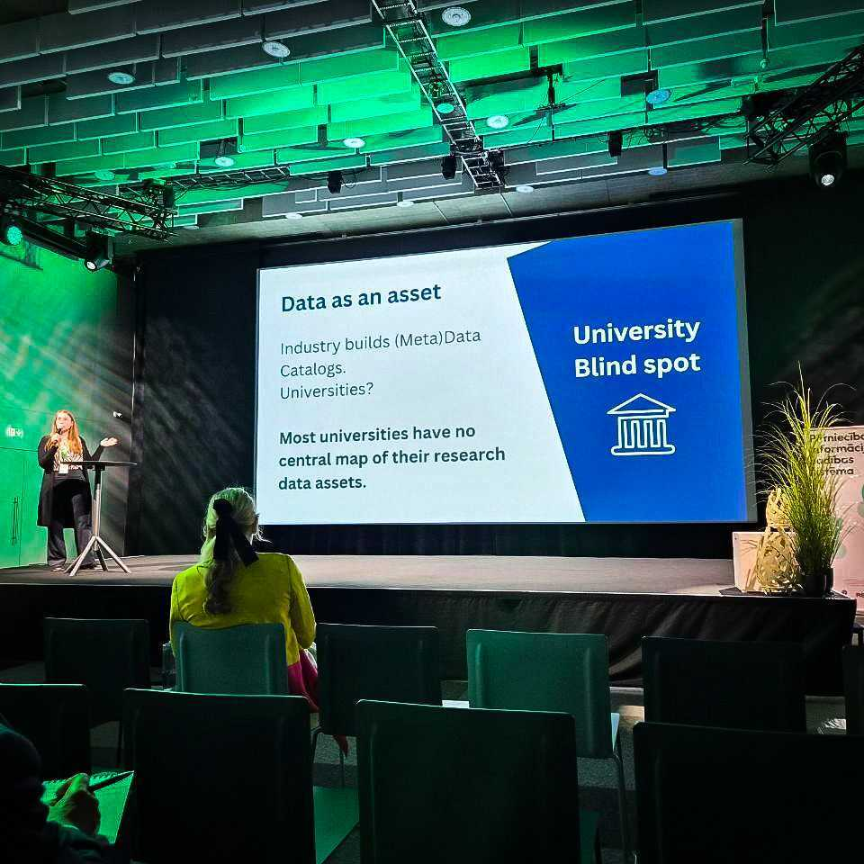
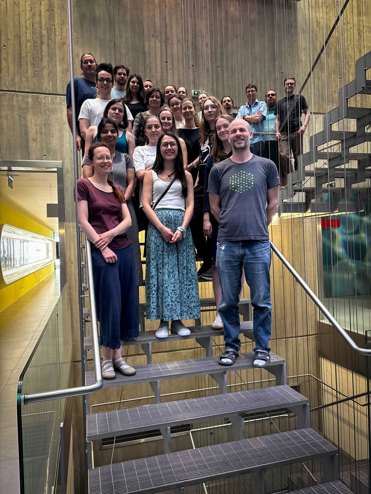
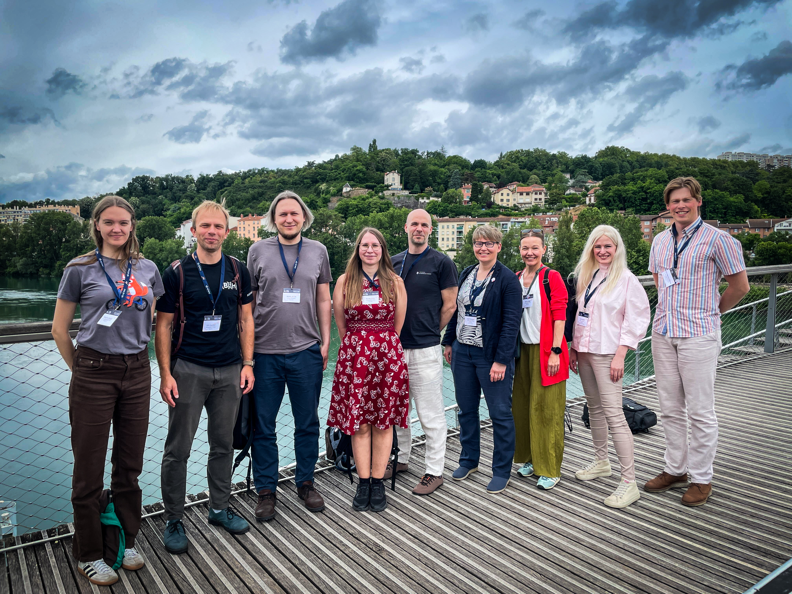

# ELIXIR Estonia’s January to June 2026 Highlights

The first half of 2026 was one of our busiest periods yet. We worked with colleagues across the University of Tartu, other ELIXIR Nodes and partner institutions in neighbouring countries. Our collaborations ranged from contributing to shared resources and speaking at seminars to running workshops and working together on projects. Research data management and training were especially active areas for us.

<!-- more -->

## ELIXIR Estonia news

  - From 9 to 15 February, the University of Tartu’s [Women in Science theme week](https://ut.ee/en/women-in-science) highlighted the role of women and girls in science, challenged gender stereotypes, and encouraged women to pursue scientific careers. Four colleagues represented ELIXIR Estonia: [Marilin Moor](https://lnkd.in/p/d8bADS4B), [Heleri Inno](https://lnkd.in/p/dtmxkKTc), [Diana Pilvar](https://lnkd.in/p/djqnTDnt) and [Kersti Jääger](https://lnkd.in/p/dARQNN_Q). We wanted to recognise both women researchers and the research support staff who help make science possible.
  - In February, Heleri attended the [ELIXIR ELEAD 2.0](https://elixir-europe.org/how-we-work/scientific-programme/people/elead2) meeting in Prague for a week of training on personal development, diversity, and equality. The mentorship programme runs until December 2026.

  - In March, the University of Tartu’s year-long [Data management and open science competence network](https://elixir.ut.ee/news/2025/05/16/DM_UT_Training/) pilot wrapped up. Heleri and Diana represented ELIXIR Estonia at the [closing seminar](https://utlib.ut.ee/et/uudis/tu-andmehaldurite-vorgustiku-seminaril-arutleti-andmehalduse-tulevikusuundade-ja) and discussed what comes next for the network. 
  - In March, aggregated allele frequency data from [the Estonian Biobank](https://genomics.ut.ee/en/content/estonian-biobank) became discoverable through Beacon in the [Genomic Data Infrastructure (GDI)](https://gdi.onemilliongenomes.eu/) central user portal. 
  - In May, Marilin, our junior research fellow, spoke at [the University of Tartu Institute of Computer Science’s](https://cs.ut.ee/en) [Data Science Seminar “Agentic AI: who does what?”](https://cs.ut.ee/en/event/data-science-seminar-agentic-ai-who-does-what). Her talk was titled “How Hard Can It Be? Our Attempt to Build an Agentic System for Microscopy Image Workflows”. [Watch](https://www.youtube.com/watch?v=V9qubnxvJV0) the seminar. 
  - In June, Uku, our research software engineer and technical coordinator, spoke about scientific software on the Estonian podcast [“Kuue Samba Taga”](https://kuku.postimees.ee/podcast/kuue-samba-taga/277763). 

## Sharing Knowledge and Best Practices

  - On 12 February, Heleri led a workshop titled [“The Data Management Support Network at the University of Tartu as a strong backbone for researchers”](https://doi.org/10.5281/zenodo.18656745) at the university’s research funding information day, [“Funding Nudge 2026”](https://elixir.ut.ee/news/2026/02/09/Grandimuks/).
  - On 13 February, Uku led a workshop titled “How I use coding agents: isolation, specs, tests, responsibility” as part of an internal AI seminar series.
  - From 17 to 26 March, we hosted our first [CodeRefinery local classroom](https://elixir.ut.ee/news/2026/02/05/CodeRefinery_march_local/), which focused on writing reproducible research code. 
  - This spring, Heleri ran [“Data Management for Project Managers”](https://doi.org/10.5281/zenodo.19492798) for the University of Tartu’s Project Management Network.
  - Priit, Diana and Hedi contributed to a [professional development programme for data engineers](https://cs.ut.ee/et/sisu/andmeinseneride-taiendkoolitusprogramm).
  - In May, we ran a [tailored course](https://lnkd.in/p/dXV9ijFB) on [“FAIR principles in Data Management”](https://doi.org/10.5281/zenodo.20556552) for the Kyiv School of Economics. The university is the Ukrainian partner in the [BRIDGE twinning project](https://bridge.kse.ua/en), which it carries out with the University of Tartu. [Read more](https://elixir.ut.ee/news/2026/08/10/FAIR_principles_data_Management_BRIDGE/) about the course. 
  - In June, Diana, Priit and Marilin ran a [tailored bioinformatics course](https://elixir.ut.ee/news/2026/08/06/Taltech_special_course_bioinformatics/) for [Tallinn University of Technology](https://taltech.ee/en/). 

## Strengthening International Collaborations

  - On 14 January, Heleri joined the [ELIXIR STEERS General Assembly](https://elixir-europe.org/events/steers-policy-event) and the Work Package 4 meeting online.
  - On 11-12 February, Diana joined the [ELIXIR Training Platform meeting](https://doi.org/10.5281/zenodo.19093067) online. 
  - On 2-5 March, Erik, our developer, and Priit Kleemann from the Estonian Biobank took part in the [GDI hackathon](https://lnkd.in/p/dTVnYAT3) in Lapland, Finland. 
  - Diana also joined collaborative writing sessions for the [FAIR Lesson Plan Handbook](https://plans.fairdata.education/) on 2 March and for the [Data Stewardship Handbook](https://elixir-europe.github.io/ds-handbook/) on 13 and 18 May.
  - From 23- 26 March, Uku and Erik attended meetings of the ELIXIR Data, Tools and Compute Platforms and the Technical Coordinators meeting in Helsinki, Finland. 
  - On 10 April, Diana continued her collaboration with Austria’s [Data Stewardship curriculum](https://postgraduatecenter.univie.ac.at/en/datasteward). She was a guest lecturer for Module 3.15 “Data Stewardship in the Natural and Life Sciences”. 
  - On 6 May, Diana attended the [Nordic Data Steward Network](https://datice.is/en/datice/nordic-data-stewardship-network) hybrid seminar organised by [CSC – IT Center for Science](https://csc.fi/en/) in Espoo, Finland. 
  - On 21 May, Hedi, our Head of ELIXIR Estonia, and Diana attended the [“Forward Together 2026”](https://vpc.lv/en/aizvadita-konference-vienoti-virziba/) in Latvia. Diana gave a talk titled [“Future-Proofing Research Data Management: How Industry Strategies Can Strengthen Research Data Governance”](https://doi.org/10.5281/zenodo.20448812). Watch the event [recording](youtube.com/watch?si=sUKpBqNKOCXwdsgo&v=pBzlb6ruxa0&feature=youtu.be). 

  - On 25-26 May, Priit and Marilin returned to Prague to teach a [course on Python basics for bioinformatics](https://www.elixir-czech.cz/events/python-basics-05-2026). 

 - On 8-10 June, our team attended the [ELIXIR All Hands Meeting 2026](https://elixir-europe.org/events/elixir-all-hands-2026) in Lyon, France. Ivan, Priit, and Hedi presented their poster [“Reviving Professorware: An Agentic Approach”](https://doi.org/10.5281/zenodo.23473552). [Read more](https://elixir.ut.ee/news/2026/11/05/AHM2026_Poster_KEGGanim/) about the poster. 

 - On 9-10 June, Uku attended the [2026 Nordic-RSE Conference](ttps://nordic-rse.org/nrse2026/) in Tromsø. 

## Celebrating Achievements

 - ELIXIR Estonia was invited to the reception during the [visit of the President of the Czech Republic and the Rector of Masaryk University](https://ut.ee/en/news/president-czech-republic-and-rector-masaryk-university-visited-university-tartu) to the University of Tartu. [Read more](https://elixir.ut.ee/news/2026/09/14/Collaboration_w_CZ/) about our collaboration with them. 
 - In May, Diana and Heleri were accepted into the [ELIXIR-GOBLET Train-the-Trainer](https://elixir-europe.org/platforms/training/train-the-trainer) Mentorship programme. Their mentor is [Bruna Piereck](https://www.linkedin.com/in/bruna-piereck-a5063526a/), deputy training coordinator at [ELIXIR Belgium](https://www.elixir-belgium.org/). The programme lasts about a year and will conclude with Train-the-Trainer sessions in Belgium and Estonia.
 - In June, two colleagues from the GDI project graduated. Karl-Martin Voovere, a software analyst, earned his bachelor’s degree, and Markus Marandi, a DevOps Engineer, earned his master’s degree. Congratulations to both! 

## Publications

 - Erik contributed to [“bio.tools: an expanded web service for research software in the life sciences”](https://www.google.com/url?q=https://doi.org/10.1093/nar/gkag420&sa=D&source=docs&ust=1794218096210052&usg=AOvVaw2f4sTJ72Jl2Z54hFgFVBNt). He developed Pub2Tools, which generates ranked draft entries for bio.tools and suggests relevant EDAM annotations. [Read more](https://elixir.ut.ee/news/2026/10/07/bio.tools_article/) about the tool. 

## Industry Collaboration

 - Ongoing collaboration with [Protobios](https://protobios.com/) regarding genome analysis and modelling.

*This text was edited with the help of AI (ChatGPT 6.1 Sol Light, developed by OpenAI).* 

